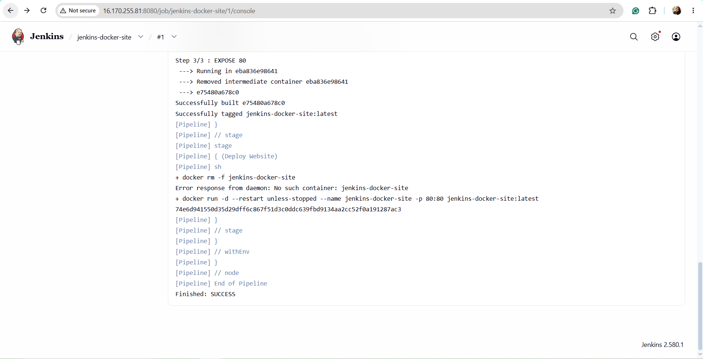
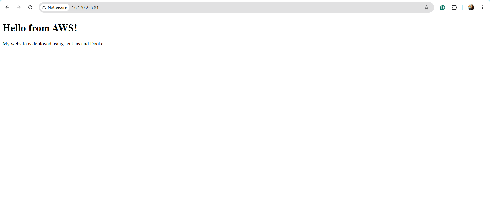

# Jenkins and Docker Website Deployment on AWS EC2

## Project Overview

This project demonstrates how to deploy a static website on AWS EC2 using Docker and Jenkins.

The website source code is stored in GitHub. Jenkins retrieves the code, builds a Docker image, and deploys the website inside a Docker container on the EC2 instance.

## Technologies Used

- **AWS EC2** – Cloud server for hosting the website
- **Ubuntu Linux** – Operating system on the EC2 instance
- **Git and GitHub** – Source code management
- **Docker** – Containerization of the website
- **Jenkins** – Automated build and deployment pipeline
- **HTML** – Website development

## Architecture

GitHub Repository → Jenkins Pipeline → Docker Image → Docker Container → Website hosted on AWS EC2

## Project Files

| File | Description |
|---|---|
| `index.html` | Contains the website's HTML content |
| `Dockerfile` | Defines how to build the Docker image |
| `Jenkinsfile` | Defines the Jenkins pipeline for building and deploying the website |
| `README.md` | Documents the project, technologies, and deployment process |

## How It Works

1. The website source code is stored in GitHub.
2. Jenkins retrieves the project files from the GitHub repository.
3. The Jenkins pipeline executes the deployment stages.
4. Docker builds an image using the Dockerfile.
5. Jenkins starts a Docker container named `jenkins-docker-site`.
6. The container serves the website on port `80`.
7. The deployed website is verified using a web browser.

## Deployment Details

- **GitHub Repository:** [jenkins-docker-site](https://github.com/MansiPandey-git/jenkins-docker-site)
- **Jenkins Job:** `jenkins-docker-site`
- **Docker Image:** `jenkins-docker-site:latest`
- **Docker Container:** `jenkins-docker-site`
- **Application Port:** `80`
- **Deployment Platform:** AWS EC2

## Screenshots

## Screenshots

### 1. Jenkins Pipeline Build Success

The Jenkins pipeline successfully built and tagged the Docker image and completed the deployment stage.

### 2. Live Website on AWS EC2

The website was successfully deployed and accessed through the EC2 instance's public IP address.

## Verification

The deployment was verified by confirming that:

- The Jenkins pipeline completed with `SUCCESS`.
- The Docker image was built and tagged successfully.
- The Docker container started successfully.
- The website was accessible through the EC2 instance's public IP address.

## Key Learnings

- Understanding how GitHub, Jenkins, Docker, and AWS EC2 work together.
- Creating a Docker image using a Dockerfile.
- Using a Jenkinsfile to automate build and deployment steps.
- Running a Docker container to serve a website.
- Troubleshooting Jenkins node availability and disk-space monitoring warnings.
- Verifying a deployment through a web browser.

## Future Improvements

- Configure automatic pipeline triggers when code changes are pushed to GitHub.
- Add automated tests to the Jenkins pipeline.
- Configure HTTPS and a custom domain.
- Explore production-ready deployment practices.

## Author

Mansi Pandey
